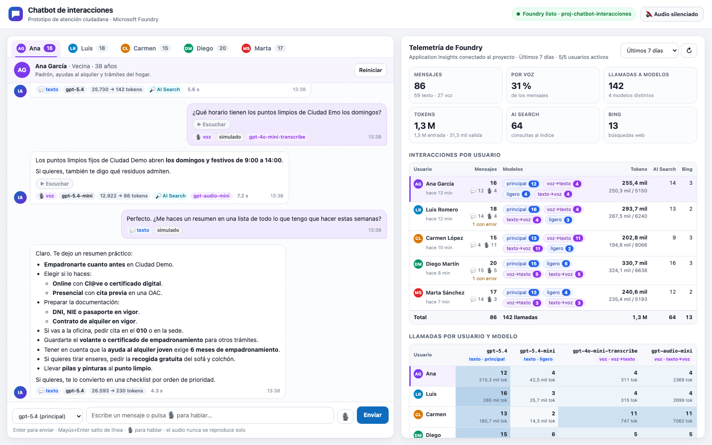
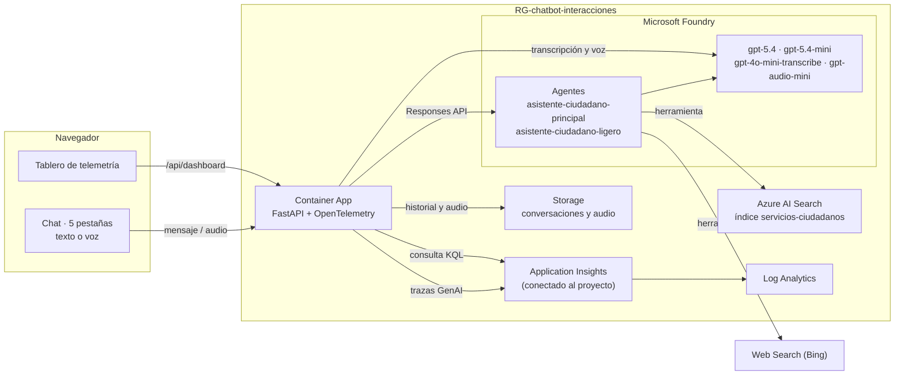

# Chatbot de interacciones · Microsoft Foundry

Prototipo de **asistente de atención ciudadana** para una administración pública ficticia ("Ciudad Demo") que enseña, en una sola pantalla, **qué hace cada usuario con la IA y cuánto consume**, medido con la telemetría de Microsoft Foundry.

- **Izquierda:** chatbot con **5 pestañas, una por usuario** (Ana, Luis, Carmen, Diego y Marta). Cada usuario puede escribir o hablar y elegir entre dos modelos de texto.
- **Derecha:** tablero que consulta el **Application Insights conectado al proyecto de Foundry** y muestra, por usuario:
  - mensajes enviados, separados en **texto** y **voz**;
  - interacciones con **cada modelo**, indicando si es un modelo de **texto o de voz**;
  - **tokens** de entrada y salida;
  - llamadas a **Azure AI Search** y a **Bing** (la herramienta *Web Search* de Foundry).



Con `azd up` se despliega todo en el grupo de recursos **`RG-chatbot-interacciones`**. El script de siembra añade a cada usuario una conversación de demo de 15 a 20 mensajes.

> [!IMPORTANT]
> Es una demo **sin autenticación**: cualquiera que tenga la URL puede conversar y consumir tokens. No la uses con datos reales y elimínala con `azd down --purge` al terminar.

Para enseñarlo en una reunión, sigue el **[guion de la demo](docs/guion-demo.md)**: 10 minutos paso a paso, con las preguntas que conviene hacer y qué contar en cada momento.

## Arquitectura



## Qué se despliega

| Recurso | Nombre | Para qué |
|---|---|---|
| Grupo de recursos | `RG-chatbot-interacciones` | Contiene todo lo demás |
| Microsoft Foundry (AI Services) | `aif-chatbot-<token>` | Modelos y Agent Service |
| Proyecto de Foundry | `proj-chatbot-interacciones` | Agentes, conexiones y trazas |
| Azure AI Search (Basic) | `srch-chatbot-<token>` | Base de conocimiento: 17 fichas de trámites de "Ciudad Demo" |
| Application Insights y Log Analytics | `appi-chatbot-<token>`, `log-chatbot-<token>` | Telemetría conectada al proyecto (pestaña *Tracing* de Foundry) |
| Container Apps (entorno y app) | `cae-chatbot-<token>`, `ca-chatbot-interacciones` | Frontal y API |
| Container Registry | `crchatbot<token>` | Imagen del frontal, construida en Azure (no hace falta Docker) |
| Storage | `stchatbot<token>` | Historial de cada usuario y audios |
| Identidad administrada | `id-chatbot-<token>` | La app accede sin claves (RBAC) a Foundry, Search, Storage y la telemetría |

Foundry y los modelos se crean en `AZURE_LOCATION` (probado en **swedencentral**). AI Search va en **spaincentral** por defecto (`AZURE_SEARCH_LOCATION`), porque en swedencentral puede devolver `InsufficientResourcesAvailable`.

### Modelos

| Uso | Despliegue | Tipo | Cómo se usa |
|---|---|---|---|
| Agente principal | `gpt-5.4` | Texto | Opción "principal" de cada pestaña |
| Agente ligero | `gpt-5.4-mini` | Texto | Opción "ligero" de cada pestaña |
| Voz a texto | `gpt-4o-mini-transcribe` | Voz | Transcribe lo que dice el usuario |
| Texto a voz | `gpt-audio-mini` | Voz | Lee en voz alta la respuesta del asistente |

Los dos agentes comparten instrucciones y herramientas (AI Search y Web Search) y solo cambia el modelo. Así se pueden comparar consumo y calidad entre usuarios. Las preguntas municipales se responden solo con el índice: Ciudad Demo es ficticia, así que la web se reserva para datos externos y actuales (el tiempo, eventos, el IPREM, normativa estatal), con una búsqueda como máximo por respuesta. Además, cada respuesta admite como máximo 3 llamadas a herramientas (`AGENT_MAX_TOOL_CALLS`). Las fuentes del índice se muestran como etiquetas sin enlace porque sus URL son de ejemplo.

Como modelo ligero se probó `gpt-5.4-nano` y se descartó: no consultaba el índice y encadenaba búsquedas web que agotaban los tokens por minuto. Cada despliegue de texto se crea con 200.000 tokens por minuto (GlobalStandard); las capacidades se cambian en [`infra/main.bicep`](infra/main.bicep).

`gpt-audio-mini` es un modelo conversacional y a veces añade una presentación ("voy a leer…"). Por eso el servidor compara la transcripción del audio generado con el texto pedido y, si sobran palabras, repite la locución una vez y se queda con la más fiel.

## Despliegue

Necesitas una suscripción de Azure con cuota para esos modelos (GlobalStandard), [Azure Developer CLI](https://aka.ms/azd) y [Azure CLI](https://aka.ms/azcli). La imagen se construye en Azure Container Registry, así que no hace falta Docker.

```bash
git clone https://github.com/jrubiosainz/chatbot-interacciones-foundry.git
cd chatbot-interacciones-foundry
azd auth login
azd env new chatbot-interacciones
azd env set AZURE_LOCATION swedencentral
azd up
```

Cuando arranca, la app crea el índice de AI Search, sube las fichas y crea o actualiza los dos agentes. Mientras tanto la cabecera muestra "Preparando entorno…".

Variables opcionales (`azd env set NOMBRE valor`, antes de `azd up`):

| Variable | Valor por defecto | Efecto |
|---|---|---|
| `AZURE_RESOURCE_GROUP_NAME` | `RG-chatbot-interacciones` | Nombre del grupo de recursos |
| `AZURE_SEARCH_LOCATION` | `spaincentral` | Región de AI Search |
| `SIMULATION_ENABLED` | `true` | Activa `POST /api/simulate`, que usa el script de siembra |
| `CAPTURE_MESSAGE_CONTENT` | `false` | Si es `true`, el texto de los mensajes también se guarda en las trazas |

## Sembrar las conversaciones de demo

[`data/conversaciones_demo.json`](data/conversaciones_demo.json) define 86 mensajes repartidos entre los 5 usuarios (15–20 cada uno), con 27 por voz y 19 con el modelo ligero. El script solo usa la biblioteca estándar de Python y envía cada mensaje a la app desplegada, de modo que todo pasa por los agentes reales y genera telemetría real:

```bash
python3 scripts/seed_conversations.py --url "$(azd env get-value SERVICE_WEB_URI)" --wait-ready
```

- Envía 2 usuarios en paralelo (`--parallel`) y reintenta los errores transitorios. Si un modelo llega a su límite de tokens por minuto, la app responde 429 y el script espera antes de reintentar.
- Si un mensaje sigue fallando, ese usuario se detiene para no dejar huecos en la conversación (`--continue-on-error` lo evita).
- `--resume` continúa desde donde se quedó, sin duplicar mensajes.
- `--reset` vacía las conversaciones antes de sembrar.
- `--users ana,luis` limita la siembra a esos usuarios.
- `--dry-run` muestra lo que se enviaría sin enviarlo.

Los mensajes "por voz" de la siembra se simulan sin micrófono. El servidor sintetiza la frase del usuario con `gpt-audio-mini`; esa llamada se marca como sintética y **no cuenta** en el tablero. Después la transcribe con `gpt-4o-mini-transcribe` y sigue el mismo camino que una nota de voz real.

## Cómo funciona la telemetría

El backend instrumenta cada turno con **OpenTelemetry** usando las convenciones semánticas GenAI y lo exporta al Application Insights conectado al proyecto de Foundry. Las mismas trazas se ven en el portal de Foundry (*Tracing*) y en el tablero de la app.

| Span | Atributos clave |
|---|---|
| `turno_usuario {modalidad}` (`app.kind = turn`) | `app.user.id`, `app.modality` (texto o voz), `app.model.selected` |
| Llamada a modelo (`app.kind = model_call`) | `gen_ai.request.model`, `app.model.type` (texto o voz), `gen_ai.usage.input_tokens`, `gen_ai.usage.output_tokens` |
| Herramienta (`app.kind = tool_call`) | `app.tool.label` (`AI Search` o `Bing (Web Search)`) |

`GET /api/dashboard?range=1h|24h|7d|30d` (por defecto, `30d`) consulta App Insights con KQL, usando la identidad de la app, y agrega por usuario y por modelo. Prueba primero el esquema clásico (`dependencies`) y, si no responde, el del área de trabajo (`AppDependencies`). La consulta exacta se puede ver desplegando el bloque "Consulta KQL" debajo del tablero.

App Insights tarda **entre 1 y 3 minutos** en ingerir los datos. Mientras tanto, el tablero marca como "en ingesta" los mensajes que la app ya guardó pero que todavía no aparecen en la telemetría.

Al reiniciar un usuario, su fila del tablero vuelve a cero. La app guarda la hora del reinicio y la consulta KQL solo cuenta la telemetría de ese usuario posterior a ella. Application Insights conserva todo, así que el histórico completo sigue disponible en el portal.

## Voz sin sorpresas

El audio nunca se reproduce solo:

- la página arranca siempre con **"Audio silenciado"**, y ese estado no se guarda;
- no hay reproducción automática: cada audio se reproduce solo al pulsar "Escuchar", y ese botón está desactivado mientras el audio esté silenciado;
- la cabecera `Permissions-Policy: autoplay=()` impide reproducir sin interacción del usuario;
- al silenciar, cambiar de usuario u ocultar la pestaña se detiene cualquier reproducción.

Para hablar, pulsa el micrófono, que pide permiso al navegador. Cada grabación dura como máximo 60 segundos.

## Ejecutar en local

```bash
python3 -m venv .venv && source .venv/bin/activate
pip install -r src/requirements.txt
cd src
azd env get-values > ../.env   # opcional: reutiliza el entorno desplegado
set -a; source ../.env; set +a
python -m uvicorn app.main:app --reload --port 8000
```

Para hablar con los agentes en local, tu usuario necesita los permisos que `azd up` asigna a quien despliega. Sin `FOUNDRY_PROJECT_ENDPOINT` la app arranca en "modo local sin Azure": se ve la interfaz, pero no se puede conversar.

## Costes y limpieza

- **AI Search Basic:** unos 75 USD al mes mientras exista.
- **Container App:** una réplica siempre encendida (0,5 vCPU y 1 GiB).
- **Modelos:** pago por token.
- **Application Insights y Log Analytics:** pago por GB ingerido.

La app limita la demo a 600 turnos por hora. Para borrarlo todo:

```bash
azd down --purge
```

## Estructura

```text
infra/                     Bicep: grupo de recursos, Foundry, modelos, Search, telemetría, Container App y RBAC
src/app/main.py            API FastAPI: chat, voz, simulación y tablero
src/app/foundry.py         Agentes de Foundry (Responses API, herramientas AI Search y Web Search)
src/app/voice.py           Transcripción y síntesis de voz
src/app/telemetry.py       Spans OpenTelemetry GenAI hacia Application Insights
src/app/dashboard.py       Consultas KQL y agregación por usuario y modelo
src/app/search_setup.py    Índice y documentos de AI Search
src/app/static/            Interfaz (HTML, CSS y JavaScript sin dependencias)
data/                      Conversaciones de demo
scripts/                   Script de siembra
docs/                      Guion de la demo y captura
```

## Licencia

[MIT](LICENSE)
